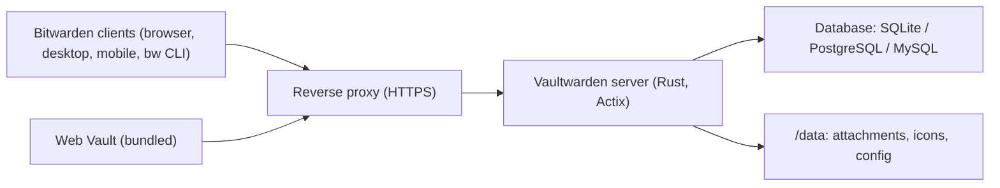

Let me ground this against the project's own README rather than memory.

## What it is

**Vaultwarden is a lightweight, self-hosted *server* that speaks the same API as the commercial Bitwarden cloud.** So: any official Bitwarden client — browser extension, desktop app, phone app, the `bw` CLI — can be pointed at *your* machine instead of Bitwarden's servers, and it behaves identically. Written in Rust (originally named `bitwarden_rs`), usually run as one Docker container, needs a few tens of MB of RAM instead of the several GB the official Java/.NET stack wants. It is **not affiliated with Bitwarden, Inc.**, so support goes to their community channels, never Bitwarden's.

## The mental model (this is the part to keep)

Think of a **hotel safe**:

- The server is the hotel: it holds the box, delivers it when you knock, and remembers that you knocked.
- Your master password is the combination. **The hotel has no copy. It cannot open the box. It never could.**
- Everything inside the box is unreadable to anyone who lacks the combination — including whoever steals the hotel.

Three consequences follow directly from that design, and they explain everything your fleet hit this week:

1. **Lose the master password → the vault is gone.** Not "contact support gone" — mathematically gone. Vaultwarden's README says it plainly: *"We cannot be held liable for any data loss."*
2. **The server being down = you are locked out**, even though nothing is lost. That is exactly your current situation: the vault is fine, but the machine hosting it (`admin01`) is off the network, so nobody can reach it, so nobody can read the pbs01 password, so backups cannot be configured.
3. **A stolen database is not a stolen password** — but it *is* an offline guessing target. Weak master passwords fall to GPU cracking, which is why the KDF (Argon2id or PBKDF2, hundreds of thousands of iterations) matters.

## How the pieces fit

Encryption and decryption happen **only in the client**, before anything crosses the network. The server stores opaque ciphertext blobs plus non-secret metadata (account email, item *folders*, collection names, device info, timestamps). Item titles and values are encrypted; that is why the server can be in a hostile datacentre and still be safe — and why the server alone can never help you recover.

## What Vaultwarden is *not*

| Misconception | Reality |
|---|---|
| "It's my backup of secrets" | It is a *store*, not a backup. If the disk dies, both the secrets and the record that you had them die together. |
| "Admin Password Reset saves me" | That flow exists, but it only works if the account was enrolled so the server holds re-wrapped key material. By default, a lost master password is unrecoverable. |
| "It has proper audit logs" | It has *basic* event logs and device info — far thinner than a commercial secrets manager. If a control says "Vaultwarden records all access events", verify it before citing it in an audit. |
| "Browsers can just open it over HTTP" | The README is explicit: the Web Vault **requires HTTPS/secure context** because it uses the WebCrypto API. This is why your instance, bound to `127.0.0.1:8090` with no TLS proxy, is usable only from the machine itself. |
| "It's Bitwarden" | Same API, different project, different support route. |

## Your fleet's actual setup (as verified this week)

- Container `jol-vaultwarden` on **admin01**, listening **loopback only**: `http://127.0.0.1:8090`.
- Data volume: `/home/jol/secrets/vaultwarden` on admin01.
- Item naming convention: `prod/{domain}/{host}/{key}`, e.g. `prod/network/n2048-admin`.
- Policy in `AGENTS.md` / `docs/architecture/secret-flow.md`: helper scripts read credentials from the vault via environment variables or interactive prompts (`getpass`), **never** as command-line arguments — because argv is visible in `ps` and shell history. That rule is why I have refused, all session, to accept the PBS token secret in chat or type it into a command line.
- ADR-003 chose Vaultwarden + External Secrets Operator for Kubernetes; the SOPS/age amendment added a second lane: **Git-versioned, age-encrypted secret files for infrastructure-as-code**, with Vaultwarden remaining the source of truth for each private identity. Two lanes, one purpose: no plaintext secrets in repositories.

## The lesson your outage just taught

Your credential store has **three single points of failure stacked on one machine**: one host (`admin01`), one disk (`/home/jol/secrets/vaultwarden`), one master password. Today the host went quiet and a *backup-configuration* task became impossible — which, in compliance language, means **availability of your restore capability depends on a password manager being reachable**. That is a real ISO 27001 concern (A.5.15 access control, A.8.13 information backup, A.5.29/A.5.30 for ICT readiness) and a SOC 2 CC7.x / A1.2 concern.

## Hardening checklist, in priority order

1. **Back up the vault data directory** — stop the container or copy the SQLite file safely (SQLite can corrupt if copied mid-write; use `sqlite3 .backup` or a filesystem snapshot), encrypt it, and put it somewhere that is *not* admin01. pbs01 is the natural target once it is administrable again.
2. **Print/escrow an offline recovery kit**: master password, account email, any TOTP seed, and an **encrypted export** of the vault (the "encrypted JSON export" is protected by its own separate passphrase — a second layer, safe to store physically). Two geographic locations. This is your key-person insurance as a solo operator.
3. **Enable Emergency Access** (Vaultwarden supports it): a trusted contact with a time-delayed access window. For a one-person operation this is the difference between "inconvenient" and "fleet unrecoverable".
4. **Make it reachable from a documented management host over TLS**: put a reverse proxy with a real certificate in front (Caddy/nginx), bind to the mgmt VLAN instead of loopback-only, and keep fail2ban on the auth endpoint. Set `SIGNUPS_ALLOWED=false`, `INVITATIONS_ALLOWED=false`, `SHOW_PASSWORD_HINT=false` (password hints are stored **unencrypted** — a classic leak), and hash `ADMIN_TOKEN` with Argon2 rather than storing it in plaintext.
5. **Decide what belongs in it at all.** Long-lived machine credentials that IaC needs should live in the SOPS/age lane (reviewable, rotatable via PR, no interactive human in the loop). Interactive/human credentials — console root passwords, switch logins, token secrets shown once — belong in the vault. Right now the pbs01 token secret is *only* in the vault, and the vault is only on one dead box: that is the gap to close.
6. **Never let backups carry key material.** This week we found your weekly `/etc/pve` config tarball had quietly archived the PVE root CA key and cluster authkey at mode 644. The vault is for secrets; backups are for configuration. Keep them separate, and encrypt the ones that must carry secrets.

## Mini-glossary

| Term | Plain meaning |
|---|---|
| Zero-knowledge / end-to-end encrypted | The server never sees plaintext; only clients hold keys. |
| Master password | The one human memorised secret; derives everything else. |
| KDF (Argon2id, PBKDF2) | Deliberately slow hashing so guessing the master password is expensive. |
| Symmetric key / key wrapping | A random 256-bit key encrypts your items; that key is itself encrypted with a key derived from your master password. |
| Send | Share a secret (file/text) via a link, with expiry and access limits, without sharing the vault. |
| Break-glass | Pre-planned emergency access path when the normal path is unavailable. |
| Key-person risk | One person (or one machine) holds the only route to critical secrets. |

**Bottom line for a student:** Vaultwarden gives you Bitwarden's security model on hardware you own, cheaply. Its security and its fragility are the *same property* — nobody but you can open it, so nobody but you can rescue you. Your current deployment has one box, one disk, one password, and no tested recovery. Fix the recovery path first; the password manager itself is already the right tool.