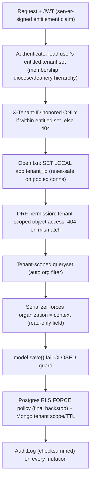

Confirmed and locked: **~1,200 LT-national websites, shared-runtime topology A.** All four Q2 decisions are now settled. Per the plan I committed to, I'll present the A3 design section-by-section, starting with **Wave −1 (isolation)** — the hard precondition.

But since Wave −1 *is* the security remediation, I won't design it blind. Let me read the rest of the settings (transactions, CORS, security headers, JWT) so the design reflects the actual current posture — and confirm the `CONN_MAX_AGE=600` pooling constraint that makes naive RLS dangerous.

This substantially sharpens Wave −1 — and surfaces a **second CRITICAL**. Two facts from the settings are decisive:

- **`ATOMIC_REQUESTS` is not set** (Django default = autocommit) **and `CONN_MAX_AGE=600`** (persistent pooled connections). That combination makes naive Postgres RLS *dangerous* — a session-level `SET app.tenant_id` would leak across requests on a reused connection. RLS here mandates `SET LOCAL` inside a per-request transaction (or `ATOMIC_REQUESTS`).
- Re-reading the middleware against the settings: `_get_tenant_info` validates only `status=ACTIVE`, **not that the requesting user belongs to the tenant** — yet tenant_id can come from the **client-controlled `X-Tenant-ID` header** (`middleware.py:166`). The docstring claims "Validates: User has access to specified tenant"; the code does not. That's **tenant impersonation**, and it would make even the fail-open write guard *pass*.

Before I design the fix, I must confirm two things rather than assume: whether `production.py` overrides the insecure defaults (SSL redirect, HSTS, secure cookies, Prometheus IP allow-list all default to *off*), and whether the JWT actually carries a tenant claim (if not, the unvalidated header is the *primary* tenant path).

`production.py` credits and gaps, verified:
- **Good:** SSL redirect, HSTS (1y + preload), secure/HttpOnly/SameSite cookies, `sslmode=require`, JSON-only renderer. Transport security is properly hardened.
- **Gaps:** (1) `ALLOWED_HOSTS` defaults to `.journeyoflife.org` but real tenant hostnames are `*.gyvenimo-kelias.lt` (`basilica-vilnius.yml:9`) — mismatch breaks topology A unless env-overridden; (2) `PROMETHEUS_ALLOWED_IPS`/`AUTH_TOKEN` are **never set in prod** despite base.py's "MUST be set" warning → `/metrics` world-readable; (3) the prod throttle override **clobbers** base.py's stricter `auth 10/hour`, `gdpr_export 5/hour`, `donation_*` limits → brute-force/abuse protection regresses in prod; (4) still no CSP.

And the configured `TOKEN_OBTAIN_SERIALIZER = apps.users.api.serializers.TokenObtainPairSerializer` **doesn't exist at that path**. Since that serializer is what would inject a tenant claim, I need to locate it before asserting how tenant identity is actually established.

`grep_code` is workspace-scoped (returned 0 — it can't reach `jol-hub`), but the Glob is decisive: **there is no `apps/users/api/` package** — only `api.py`, `serializers.py`, `auth_urls.py`. So `SIMPLE_JWT["TOKEN_OBTAIN_SERIALIZER"] = "apps.users.api.serializers.TokenObtainPairSerializer"` points at a **non-existent module path**. Let me resolve where the real token serializer lives and whether it injects a tenant claim — this determines whether tenant identity comes from a trustworthy JWT or from the unvalidated `X-Tenant-ID` header.

This is the decisive link. The **real** serializer `apps.users.serializers.TokenObtainPairSerializer` (`serializers.py:136-142`) only adds `user` to the *response body* — it does **not** override `get_token()`, so it injects **no `tenant_id`/`organization_id` claim** into the JWT. And `SIMPLE_JWT` points at the non-existent `apps.users.api.serializers` path. If the custom `LoginView` also fails to mint a tenant claim, then the JWT tenant path is dead and the **unvalidated `X-Tenant-ID` header becomes the primary tenant source** — a complete isolation bypass. I must confirm `LoginView` before asserting a CRITICAL chain.

Verified end-to-end. `LoginView` (`views.py:40-49`) uses `TokenObtainPairSerializer`, which overrides only `validate()` (adds `user` to the response) and **never overrides `get_token()`** — so the access token carries **no `tenant_id`/`organization_id` claim**. The JWT tenant path is therefore dead, and tenant identity falls through to the **client-controlled `X-Tenant-ID` header**, which `_get_tenant_info` accepts after checking only `status=ACTIVE` — never membership. I also found the same unscoped pattern in the **users** app (`UserListView`/`UserDetailView` have no tenant/admin scoping), so this is **systemic, not content-only**.

Two accuracy corrections to my prior message, now that I've read further:
- The broken `TOKEN_OBTAIN_SERIALIZER` path is **dead config**, not a login-breaker — `LoginView` sets `serializer_class` explicitly. Downgrade that finding.
- The prod throttle "clobber" is likely **cosmetic** — sensitive endpoints use class-based throttles (`AuthRateThrottle`, `GDPRExportThrottle` from `apps.core.throttling`), not `DEFAULT_THROTTLE_RATES`. ⚠ verify `apps/core/throttling.py` rates before treating it as a hole.

I'm now confident enough to present the design. Here is **Section 1 of 3**.

---

# A3 Design — Section 1/3: Wave −1 · Tenant Identity & Isolation

**Roadmap:** §1 Wave −1 (isolation — *this section*) → §2 Wave 0 (LT fixtures + shared-runtime resolver for ~1,200) → §3 Wave 1+ (flip resolver to the secured API; fixtures→dev-seed).

## 1.1 The verified threat chain (why Wave −1 is a hard blocker)

| # | Fact (verified) | Evidence |
|---|---|---|
| C1 | JWT carries **no tenant claim** | `serializers.py:136-142` (no `get_token` override); `views.py:40-49` |
| C2 | Tenant identity = **unvalidated `X-Tenant-ID` header**; membership never checked (docstring claims it is) | `middleware.py:166,239-273` vs docstring `:107-109` |
| C3 | Content API: read unscoped, `organization` client-writable, model guard fail-**open** (passes when context==target, which the attacker sets) | `views.py:22-44`, `serializers.py:65-84`, `models.py:129-132` |
| C4 | "RLS" claimed, **not implemented** (no SQL/policies); `ATOMIC_REQUESTS` unset + `CONN_MAX_AGE=600` make naive RLS leak-prone | `middleware.py:6`; `base.py:162`; no `.sql` |
| C5 | Same unscoped pattern in **users** app → systemic | `views.py:177-193` |

**Net:** any authenticated user can set `X-Tenant-ID: <victim-org>` and read/write that tenant's Art. 9 content, and the fail-open guard *ratifies* it. **Controls breached:** OWASP A01:2021 · SOC 2 CC6.1/CC6.2/CC6.3/CC7.2 · GDPR Art. 9/Art. 32/Art. 5(1)(f) · ISO 27001 A.8.18/A.8.20/A.8.22/A.8.27. At ~1,200 tenants this is an Art. 33 breach-notification candidate. **A3 cannot promote the API to source-of-truth until this is closed** — and it's why git-PR fixtures remain the compliant interim.

## 1.2 Target isolation architecture — fail-closed, defense-in-depth

**Principle:** tenant identity is derived from **server-verified entitlement**, never from client input; every layer denies by default; the **database is the non-bypassable backstop**.

## 1.3 Components (build once, apply fleet-wide)

| Unit | What it does | How it's used | Depends on |
|---|---|---|---|
| **Entitlement service** | Resolves the user's *entitled* tenant set (direct `OrganizationMember` + hierarchical children via `parent_diocese`) | Called by middleware; source of truth for "which tenants may I act as" | `organizations` models |
| **Signed tenant claim** | `get_token()` override mints `tenant_id`/entitlement scope server-side (fixes C1); `X-Tenant-ID` demoted to a *selector within* the entitled set (fixes C2) | JWT issuance + middleware | Entitlement service |
| **Per-request tenant binding** | `SET LOCAL app.tenant_id` inside a transaction; `ATOMIC_REQUESTS=True` (or explicit wrapper) + reset on connection reuse (fixes C4 pooling leak) | Middleware → DB session | Postgres |
| **Postgres RLS** | `CREATE POLICY … USING (organization_id = current_setting('app.tenant_id'))` + `FORCE ROW LEVEL SECURITY`; app connects as a **dedicated non-owner role** (RLS is bypassed for owners/superusers) | Raw-SQL migrations on every Art. 9 table | Tenant binding |
| **Tenant-scoped manager + DRF permission** | Auto-filters querysets by context; object access returns **404** (no enumeration) on mismatch (fixes C3-read, C5) | `get_queryset()`/global filter backend + permission class | Tenant binding |
| **Serializer org-forcing mixin** | `organization` read-only, set from context (fixes C3-write) | All tenant-scoped serializers | Tenant binding |
| **Fail-CLOSED model guard** | Replace `except ImportError: pass` / `except Exception: debug` with **deny + WARN/ERROR + AuditLog** | Every `save()` | Entitlement service |
| **Audit wiring** | Emit checksummed `AuditLog` on content/user mutations (SOC 2 CC7.2, Art. 5(2)) | Signals/view hooks | `AuditLog` (exists) |
| **Config remediation** | Set `PROMETHEUS_ALLOWED_IPS`+token; `ALLOWED_HOSTS`/CORS regex for `*.gyvenimo-kelias.lt`; add CSP; fix dead `TOKEN_OBTAIN_SERIALIZER`; remove `postgres/postgres` default | `production.py` | — |

## 1.4 Error handling (fail-closed, no silent skips)
Missing/unverifiable tenant context → **deny** (403/404) + WARN + audit. `X-Tenant-ID` outside entitled set → **404** (indistinguishable from non-existent, per `seed-data/registry.ts:7-9`). RLS violation surfacing from DB → **404** + security-event log. No `except: pass` on any isolation path.

## 1.5 Testing & exit gate (Wave −1 is DONE only when these pass in CI)
Adversarial isolation suite: (a) tenant A reads/writes B → 404; (b) forged `X-Tenant-ID` → 404; (c) raw SQL with wrong `app.tenant_id` → 0 rows (RLS proof); (d) missing context → deny, not skip; (e) pooled-connection reuse → no tenant leak; (f) every mutation writes an AuditLog row. Plus a manual red-team pass. This operationalizes the *Tenant Isolation Testing Requirements* standard.

## 1.6 Decisions I need to lock §1 (I've recommended a default for each)
1. **Isolation model:** RLS backstop **+** app-scoping (recommended) vs app-only? *(RLS is the only fail-closed layer that survives app bugs — strongly advised for Art. 9.)*
2. **Cross-tenant response:** **404 no-enumeration** (recommended) vs 403?
3. **Tenant identity:** server-signed entitlement claim + membership/hierarchy validation, `X-Tenant-ID` demoted to selector-within-entitled-set — agree?
4. **Hierarchy entitlement:** define diocese→deanery→parish admin scope **now** (recommended — ~1,200 will have hierarchical admins) vs defer?
5. **Tenant API contract:** add `GET /api/v1/tenants` (server-to-server, no enumeration) vs repoint resolver to `/api/v1/organizations/`; and **retire** vs **redirect** `jol-backend-platform`?

---

**Does §1 (Wave −1) look right?** Confirm the five sub-decisions (or accept my recommended defaults) and I'll present **§2 Wave 0** — the LT fixture schema extension (governance fields + schedule recurrence + `pl` groundwork), the shared-runtime resolver/hostname routing for ~1,200, and the per-country deploy reconciliation (`jol-deploy` per-tenant `vm:` → shared runtime). No spec is written and no code touched until all three sections are approved.